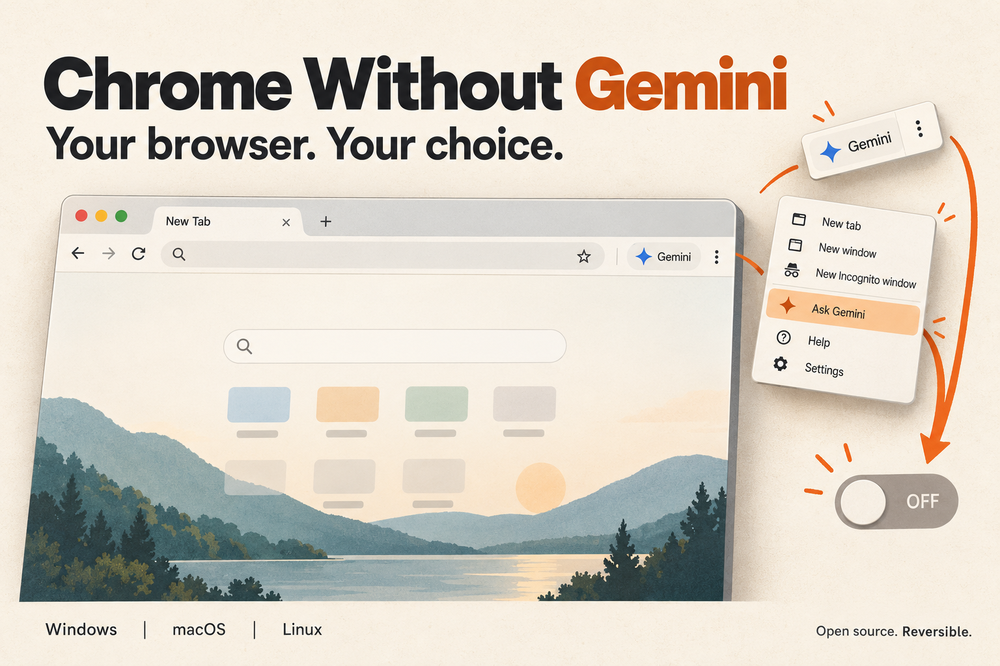

<p align="center">
  
</p>

<p align="center">
  <a href="https://github.com/theparitt/chrome-without-gemini/releases/latest"><strong>Download the app</strong></a>
  &nbsp; · &nbsp;
  <a href="#what-it-changes">What it changes</a>
  &nbsp; · &nbsp;
  <a href="#undo">Undo</a>
  &nbsp; · &nbsp;
  <a href="chrome_without_gemini">Read the source</a>
</p>

<p align="center">
  <a href="https://github.com/theparitt/chrome-without-gemini/actions/workflows/release.yml"></a>
  <a href="LICENSE"></a>
  
</p>

# Chrome Without Gemini

A small desktop app for people who want Chrome's **Ask Gemini** right-click item and
**Gemini button beside the tabs** out of the way. Two separate controls, a clear undo
path, and public source you can inspect.

**Download, open, choose. No Python installation. No compiling.**

## Fastest: copy this prompt into your AI assistant

An assistant with access to your terminal can download and run the CLI for you.
A chat-only assistant can give you the exact commands to paste.

```text
Remove Chrome's Ask Gemini right-click item and Gemini tab button on my computer
using https://github.com/theparitt/chrome-without-gemini.
Read docs/AI-QUICKSTART.md and docs/CLI.md from that repository. Detect my OS and
CPU architecture, download the matching standalone CLI from its latest release,
and verify it against SHA256SUMS.txt. No Python installation or compilation.
Run --help and status first, then apply the documented action for my goal.
For full removal on macOS, export the profile and guide me through installation.
For full removal on Linux, create the dedicated launcher and explain how to use it.
For button-only hiding, wait until I quit Chrome, then use hide-button instead.
Don't force-close Chrome or publish my account names, paths, or preferences.
Keep the recovery file and give me the exact Undo command. Explain any remaining
manual step; don't say Gemini is disabled until the platform verification is done.
If you cannot run commands on my computer, give me the shortest commands to run.
```

Want **only the top-right button hidden**? Replace the first line with:
`Hide only Chrome's Gemini tab button. Keep the rest of Gemini available.`
The assistant should use `hide-button` after you quit Chrome, rather than `disable`.

[Detailed AI runbook](docs/AI-QUICKSTART.md) · [CLI quick start and commands](docs/CLI.md)

## Download

Get the files from the [latest release](https://github.com/theparitt/chrome-without-gemini/releases/latest).

| Your computer | Ready-to-run download | Open it |
| --- | --- | --- |
| Windows 10/11 · Intel / AMD 64-bit | [Windows `.exe`](https://github.com/theparitt/chrome-without-gemini/releases/latest/download/chrome-without-gemini-windows-x64.exe) | Double-click the executable. |
| macOS 15+ · Apple Silicon | [Mac ARM `.zip`](https://github.com/theparitt/chrome-without-gemini/releases/latest/download/chrome-without-gemini-macos-arm64.zip) | Unzip; open `ChromeWithoutGemini.app`. |
| macOS 15+ · Intel | [Mac Intel `.zip`](https://github.com/theparitt/chrome-without-gemini/releases/latest/download/chrome-without-gemini-macos-x64.zip) | Unzip; open `ChromeWithoutGemini.app`. |
| Linux · Intel / AMD 64-bit | [Linux `.tar.gz`](https://github.com/theparitt/chrome-without-gemini/releases/latest/download/chrome-without-gemini-linux-x64.tar.gz) | Extract; open `ChromeWithoutGemini`. |

### Standalone CLI downloads

These console executables include Python and do not require Tk, Git, or compilation.

| Your computer | CLI download |
| --- | --- |
| Windows x64 | [CLI `.exe`](https://github.com/theparitt/chrome-without-gemini/releases/latest/download/chrome-without-gemini-cli-windows-x64.exe) |
| Mac Apple Silicon | [CLI ARM `.tar.gz`](https://github.com/theparitt/chrome-without-gemini/releases/latest/download/chrome-without-gemini-cli-macos-arm64.tar.gz) |
| Mac Intel | [CLI Intel `.tar.gz`](https://github.com/theparitt/chrome-without-gemini/releases/latest/download/chrome-without-gemini-cli-macos-x64.tar.gz) |
| Linux x64 | [CLI `.tar.gz`](https://github.com/theparitt/chrome-without-gemini/releases/latest/download/chrome-without-gemini-cli-linux-x64.tar.gz) |

After downloading, open a terminal in that folder (extract archives first):

```powershell
# Windows: remove both Gemini entry points.
.\chrome-without-gemini-cli-windows-x64.exe disable
```

```bash
# Linux: create the launcher, then quit Chrome and use Chrome (Without Gemini).
./ChromeWithoutGeminiCLI disable

# macOS: export the policy, then open it and install it in System Settings.
./ChromeWithoutGeminiCLI export-macos-policy ChromeWithoutGemini.mobileconfig
open ChromeWithoutGemini.mobileconfig
```

Use `--help` for commands, `status` to inspect settings, and `restore-gemini` to undo
(on macOS it explains how to remove the installed profile). See [CLI.md](docs/CLI.md)
for button-only hiding and verification. `disable` removes both entry points by
disabling the integration; you do not also need `hide-button`.

The Linux desktop app needs a graphical desktop, glibc 2.35+ (for example Ubuntu 22.04+), and
standard Google Chrome stable. Windows ARM, Linux ARM, Flatpak, Snap, Chromium,
Beta, Canary, and ChromeOS are outside this first release's support scope.

Community builds are **unsigned**. Windows SmartScreen or macOS Gatekeeper may
ask you to review an unknown publisher. Read the source and build logs before
deciding to open the app; do not turn off your operating system's protections.
On macOS, Apple's per-app approval is in **System Settings → Privacy & Security**.

## Choose what to remove

| Control | Right-click “Ask Gemini” | Gemini tab / toolbar button | Other Gemini entry points |
| --- | --- | --- | --- |
| **Remove Gemini from Chrome** | Removed when the policy / launcher is effective | Disabled with the integration | Disabled with the integration |
| **Hide only the tab / toolbar button** | Unchanged | Hidden in selected profiles | Unchanged |

Chrome does not expose a supported policy just for the Gemini right-click row.
The first option therefore disables the whole built-in Gemini integration.
The second option changes Chrome's button visibility preference.

Neither option removes the Gemini website, AI results on websites, all Chrome AI
features, or downloaded AI model files. Chrome updates and experiments can change
these controls; report the Chrome version when something stops working.

### Windows

1. Open the app and click **Disable Gemini**.
2. Save unfinished work and restart Chrome.
3. Open `chrome://policy`. Look for **GeminiSettings = 1**, with status **OK**.

The policy is scoped to your current Windows account. If Windows denies access,
close the app and run it as administrator **using that same account**. The app
does not request elevation at startup; button hiding usually needs none.

Chrome may show **“Managed by your organization”** because a local policy is set.
That label alone does not enroll your computer in anyone else's management service.
Existing organization policies can take precedence; this app does not bypass them.

### macOS

1. Click **Export macOS policy…** and save the `.mobileconfig` file.
2. Open it, then go to **System Settings → General → Device Management** to review
   and install **Chrome Without Gemini**. System Settings may request authentication.
3. Restart Chrome and verify **GeminiSettings = 1**, status **OK**, at `chrome://policy`.

The removable user configuration profile contains one Chrome policy:
`GeminiSettings = 1`. **Exporting the file alone does not disable Gemini.** The app
does not claim installation success; Chrome's policy page is the verification step.

### Linux

1. Click **Create AI-off launcher**.
2. Quit every Chrome process, including background processes.
3. Open **Chrome (Without Gemini)** from your application menu.
4. In `chrome://version`, verify that the command line includes `--disable-features=Glic`.

Google's policy definition currently lists Linux support for `GeminiSettings` as
future work. This app therefore creates a separate desktop launcher with a Chrome
feature switch. **This is an experimental fallback.** It applies only when that
launcher starts a fresh Chrome process; it does not modify other launchers or your
default browser. Opening it while Chrome is already running cannot change that
running process's switches. If `Glic` is renamed or removed, the fallback may stop working.

### Hide just the button on any supported platform

Quit Chrome completely, select your profiles, then click **Hide selected buttons**.
Reopen Chrome. The right-click entry remains unless you also disable the integration.

The app refuses to edit profile preferences while Chrome is running. It will never
force-close Chrome or discard open work. Use **Choose Chrome folder…** if you keep
Chrome stable's user-data directory somewhere other than its standard location.

Profile selectors show generic folder labels such as **Default profile** and
**Profile 1**, never Chrome account display names. The app does not transmit these
settings or names anywhere. Keep local profile data and troubleshooting screenshots
out of public issues.

## What it changes

| Platform / option | Exact change | Scope |
| --- | --- | --- |
| Windows · disable Gemini | `HKCU\Software\Policies\Google\Chrome\GeminiSettings` → `REG_DWORD 1` | Current Windows account |
| macOS · disable Gemini | Exported user profile, Chrome payload with `GeminiSettings: 1` | User who installs the profile |
| Linux · disable Gemini | New `$XDG_DATA_HOME/applications/chrome-without-gemini.desktop` (default `~/.local/share/applications/`) with `--disable-features=Glic` | Starts made through that launcher |
| All · hide button | Selected profile's `Preferences` → `glic.pinned_to_tabstrip: false` | Selected Chrome profiles |

Preference files are read and rewritten as JSON. The app changes that one value;
it does not copy your profile into a backup or modify bookmarks, passwords,
extensions, browser binaries, or Chrome's update settings.

Original values are saved **before changes** in a small local `changes.json`:

| Platform | Recovery folder |
| --- | --- |
| Windows | `%LOCALAPPDATA%\ChromeWithoutGemini` |
| macOS | `~/Library/Application Support/Chrome Without Gemini` |
| Linux | `$XDG_STATE_HOME/chrome-without-gemini` (default `~/.local/state/`) |

Keep that file until you have undone your changes. It stores original settings and
profile paths; it does not store full preferences or browsing history. Closing or
deleting the app does not undo an applied setting.

## Undo

- **Windows:** click **Undo Gemini change**. The app restores the previous registry
  value and type, or removes its value if none existed before. Restart Chrome.
- **macOS:** remove the **Chrome Without Gemini** profile in **System Settings →
  General → Device Management**, then restart Chrome. Deleting the exported file
  does not uninstall a profile.
- **Linux:** click **Undo Gemini change** to remove the launcher created by this app.
  Fully quit Chrome and use your normal launcher again.
- **Button hiding:** quit Chrome, then click **Undo button changes**. The app restores
  the original button preference in the profiles it changed.

Undo stops if it detects a conflicting newer value, edited launcher, or missing
profile. It preserves the recovery file so you can review the situation. Repeated
applications retain the first original value rather than replacing the backup.

## Read the source, follow the build

The application uses Python's standard library and Tk. Its runtime performs no
network requests. The standalone CLI does not import or bundle Tk. There are no accounts, analytics, background services, scheduled
tasks, downloaded payloads, browser injections, or automatic updates. It does not
ask for your Google credentials. It opens the macOS profile file only after you
choose the export action.

| File | What to review |
| --- | --- |
| [`platforms.py`](chrome_without_gemini/platforms.py) | Registry value, macOS profile contents, Linux launcher and Undo |
| [`core.py`](chrome_without_gemini/core.py) | Profile discovery, process checks, JSON edits, recovery journal |
| [`gui.py`](chrome_without_gemini/gui.py) | Every button and action in the desktop app |
| [`cli.py`](chrome_without_gemini/cli.py) | Optional command-line interface to the same controls |
| [`test_controls.py`](tests/test_controls.py) | Isolated tests for restore, conflicts, partial failures, and platform output |
| [`release.yml`](.github/workflows/release.yml) | Native builds on public GitHub-hosted Windows, macOS and Linux runners |
| [`build.py`](scripts/build.py) | Packaging with PyInstaller, no obfuscation or UPX compression |

Tagged releases build on each target operating system, run backend tests and a
packaged GUI launch check, then publish executables with
[`SHA256SUMS.txt`](https://github.com/theparitt/chrome-without-gemini/releases/latest/download/SHA256SUMS.txt).
GitHub Actions dependencies are pinned to commit hashes; packaging tool versions
are pinned in [`requirements-build.txt`](requirements-build.txt). A checksum checks
file integrity; it is not an independent security audit. Builds are inspectable,
but are not claimed to be bit-for-bit reproducible.

The automated suite uses temporary profile fixtures and a fake Windows registry.
It does not change real Chrome profiles. These tests and launch checks do **not**
prove end-to-end Gemini removal in every signed-in Chrome session. Use the platform
verification steps above and include `chrome://version` information in bug reports.

## For contributors

Users do not need these steps. To run or build from source yourself:

Use your GitHub no-reply email for commits if you want to keep your personal email
private. Do not commit real Chrome preferences, recovery files, or screenshots that
include account information. Release builds run on clean GitHub-hosted runners.

```bash
python -m venv .venv
# Activate .venv for your shell, then:
python -m pip install -r requirements-build.txt
python -m unittest discover -s tests -v
python -m ruff check .
python launch.py
python scripts/build.py
```

Build on the target OS. Python must include Tk (Linux source users may need their
distribution's `python3-tk` package). Packaged release users do not need Python or Tk
installed separately. The Linux package still needs the system's graphical libraries.

Optional CLI, from a source checkout:

```bash
python -m chrome_without_gemini.cli status
python -m chrome_without_gemini.cli disable
python -m chrome_without_gemini.cli hide-button
python -m chrome_without_gemini.cli restore-button
python -m chrome_without_gemini.cli restore-gemini
python -m chrome_without_gemini.cli export-macos-policy ChromeWithoutGemini.mobileconfig
```

`hide-button` acts on all discovered profiles in CLI mode. Use the desktop interface
for profile selection. `--chrome-root` and `--state-root` go before the command.
The source CLI needs Python 3.11+ but no pip packages and no Tk. The standalone CLI
downloads above do not require Python at all.

## Why these controls

- Google's [GeminiSettings policy definition](https://raw.githubusercontent.com/chromium/chromium/main/components/policy/resources/templates/policy_definitions/GenerativeAI/GeminiSettings.yaml)
  defines `1` as disabled and lists platform support.
- Chromium's [Gemini preferences](https://raw.githubusercontent.com/chromium/chromium/main/chrome/browser/glic/glic_pref_names.h)
  define `glic.pinned_to_tabstrip` as the button visibility preference.
- Chromium's [Gemini enabling logic](https://raw.githubusercontent.com/chromium/chromium/main/chrome/browser/glic/public/glic_enabling.cc)
  checks the Gemini policy and `Glic` feature before exposing entry points.
- Google documents [macOS configuration profiles](https://support.google.com/chrome/a/answer/9020077)
  and [Chrome policy deployment](https://support.google.com/chrome/a/answer/187202).

Documentation checked on 25 October 2026. Chrome may change these mechanisms.

## Credits and license

[MIT](LICENSE). Independent project; not affiliated with Google. Chrome and Gemini
are Google's trademarks. The README hero is an AI-generated conceptual illustration,
not an application screenshot; its [generation prompt](docs/hero-prompt.txt) is included.

